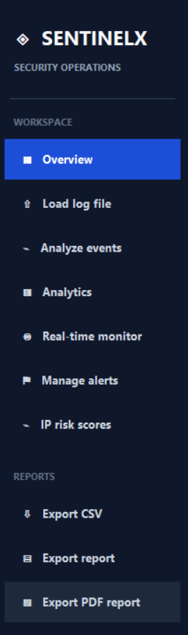

# SentinelX — Security Event Intelligence

**Monitor. Detect. Investigate. Protect.**

SentinelX is a Python-based desktop application for security log analysis and suspicious activity detection. It provides a graphical interface for importing authentication logs, analyzing security events, identifying repeated failed login attempts, ranking suspicious IP addresses, filtering records, storing events in SQLite, and exporting security reports.

The project combines log parsing, rule-based detection, persistent data storage, event investigation, and reporting in one desktop application. It was developed as a practical cybersecurity and software development project, with an emphasis on modular code, data integrity, automated testing, and measurable performance.

## Screenshots

The following screenshots demonstrate the application's interface and main workflows.

### Home Screen


### Dashboard



### Security Event


### Alert Management


### IP Risk Ranking


### Event Filtering


### Saving File


### PDF Final Report


### Another Log Load File


## Core Features

### Security Log Processing

SentinelX reads security log files and converts supported log entries into structured event records. The parser validates timestamps and IPv4 addresses and identifies invalid log lines instead of treating every input line as a valid event.

The application has been tested with a sample authentication log containing 50,000 fictional events.

### Security Event Management

Parsed events can be stored in a local SQLite database and retrieved for review. Event records include fields such as:

- Timestamp
- Severity
- Username
- IP address
- Event type

The database layer supports event insertion, retrieval, record counting, text-based searching, and duplicate prevention.

### Suspicious Activity Detection

The detection engine analyzes event patterns to identify potentially suspicious behavior. One tested detection scenario focuses on repeated failed login attempts associated with individual IP addresses.

Detection results can be used to highlight IP addresses that warrant further investigation. These are rule-based findings, not proof that an IP address or user is malicious.

### IP Risk Ranking

SentinelX identifies IP addresses associated with detected suspicious activity and presents the results for investigation. In the recorded 50,000-event detection benchmark, 14 unique IP addresses associated with failed-login activity were flagged by the tested rule.

The ranking reflects the application's detection logic and should not be interpreted as a complete threat-intelligence assessment.

### Event Filtering and Search

Users can search stored events using text-based filters. This helps narrow down records by fields such as timestamps, severity, usernames, IP addresses, and event types.

### Importing Additional Logs

Users can load additional log files to analyze different datasets without relying exclusively on the original sample log. The application was tested with a separate authentication test log containing fictional security events.

### CSV and PDF Reporting

SentinelX supports exporting security data to CSV and generating PDF reports. These features make it easier to review findings outside the application and retain reports for documentation or analysis.

### Persistent Database Storage

SQLite provides local storage for event records. Database safety tests verify that new records can be saved, duplicate events are skipped, and stored data remains available after creating a new database connection.

## Technology Stack

| Component | Technology |
|---|---|
| Programming language | Python |
| Desktop graphical interface | Tkinter |
| Database | SQLite |
| Log processing | Custom Python log parser |
| Detection logic | Custom Python detection engine |
| Data export | CSV and PDF |
| Automated testing | Python `unittest` |
| Development environment | Visual Studio Code |

## Project Architecture

The application is organized into separate modules to keep its major responsibilities distinct.

| File | Responsibility |
|---|---|
| `main.py` | Application entry point and graphical interface |
| `log_parser.py` | Parses and validates security log entries |
| `detection_engine.py` | Detects suspicious event patterns |
| `database.py` | Stores, retrieves, searches, and counts events |
| `report_exporter.py` | Handles report and data export functionality |
| `security_features.py` | Contains supporting security-related functionality |
| `benchmark.py` | Log-processing benchmark |
| `benchmark_detection.py` | Detection-engine benchmark |
| `benchmark_database.py` | Database performance benchmark |
| `benchmark_dashboard.py` | Dashboard processing benchmark |
| `benchmark_table.py` | Table insertion benchmark |

## Project Structure

```text
SentinelX/
├── main.py
├── log_parser.py
├── detection_engine.py
├── database.py
├── report_exporter.py
├── security_features.py
├── benchmark.py
├── benchmark_detection.py
├── benchmark_database.py
├── benchmark_dashboard.py
├── benchmark_table.py
├── sample_logs/
│   └── sample_auth.log
├── data/
│   ├── security_logs.db
│   └── benchmark_security_logs.db
├── tests/
│   ├── test_security_features.py
│   ├── test_log_parser.py
│   └── test_detection_engine.py
├── reports/
├── Screenshots/
├── test_database_safety.py
├── requirements.txt
└── README.md
```

*Note: The structure above illustrates the main project files. Your local folders and files may differ depending on which generated files and databases are present.*

## Installation and Execution

### Requirements

- Python 3
- Tkinter support
- The SentinelX source files
- Required Python packages listed in `requirements.txt`

No separate database server is required because the application uses SQLite.

### Install Dependencies

Open a terminal in the project root directory and execute:

```bash
py -m pip install -r requirements.txt
```

### Run SentinelX

Execute:

```bash
py main.py
```

Alternatively, use:

```bash
python main.py
```

### Run the Unit Test Suite

Execute:

```bash
py -m unittest discover -s tests -v
```

### Run the Database Safety Test

If `test_database_safety.py` is present in the project root, execute:

```bash
py test_database_safety.py
```

### Run the Benchmarks

Run the benchmark scripts individually from the project root:

```bash
py benchmark.py
py benchmark_detection.py
py benchmark_database.py
py benchmark_dashboard.py
py benchmark_table.py
```

These commands execute the corresponding benchmark scripts. Their output depends on the current environment and implementation.

## Testing Results

The application was tested using automated unit tests, a dedicated database safety test, sample log datasets, and separate performance benchmarks.

### 1. Automated Unit Tests

| Metric | Result |
|---|---:|
| Tests executed | 39 |
| Tests passed | 39 |
| Tests failed | 0 |
| Latest reported execution time | 0.045 seconds |
| Overall result | PASS |

The latest full unit test run completed successfully using Python's `unittest` test discovery. An earlier run completed in 0.042 seconds.

### 2. Database Safety Tests

| Test | Expected outcome | Result |
|---|---|---|
| Save a new event | One record is saved | PASS |
| Save the same event again | Duplicate is skipped | PASS |
| Reconnect to the database | Previously saved event remains available | PASS |

**Database safety result: 3 out of 3 checks passed.**

These checks were performed against a temporary test database, keeping the tests separate from the production application database.

### 3. Log Parser Benchmark

Dataset: 50,000 log events from the sample authentication dataset.

| Metric | Recorded result |
|---|---:|
| Total events processed | 50,000 |
| Valid events | 50,000 |
| Invalid lines | 0 |
| Processing time | 0.988 seconds |
| Average throughput | Approximately 50,630 events/second |
| Dataset size | Approximately 4.95 MB |

The parser benchmark completed successfully on a dataset containing 50,000 valid events.

### 4. Detection Engine Benchmark

Dataset: 50,000 events.

| Metric | Recorded result |
|---|---:|
| Total events analyzed | 50,000 |
| Failed-login events | 14,918 |
| Unique IP addresses associated with failed logins | 14 |
| IP addresses flagged by the tested rule | 14 |
| Processing time | 0.0778 seconds |
| Average throughput | Approximately 643,000 events/second |

The benchmark demonstrated that the tested detection logic processed the dataset in approximately 0.078 seconds. The flagged-IP count represents the output of the configured rule for this dataset, not a general detection accuracy rate.

### 5. SQLite Database Benchmark

Dataset: 50,000 events, using the separate benchmark database.

| Operation | Recorded time |
|---|---:|
| Bulk insertion | 0.2616 seconds |
| Record count query | 0.0086 seconds |
| Event retrieval | 0.2286 seconds |
| Duplicate-check benchmark | 0.0163 seconds |

The benchmark evaluated event insertion, counting, retrieval, and duplicate checking. These are measured operation times, not guaranteed response times for all database sizes or hardware configurations.

### 6. Dashboard Processing Benchmark

Dataset: 50,000 events.

| Metric | Recorded result |
|---|---:|
| Total events processed | 50,000 |
| Failed-login events | 14,918 |
| Unique IP addresses associated with failed logins | 14 |
| Base flagged IP addresses | 14 |
| Burst alerts | 3 |
| Average processing time | 0.2606 seconds |
| Median processing time | 0.2418 seconds |
| Median-based throughput | Approximately 206,782 events/second |

This benchmark measured the dashboard-related processing workflow. It was an approximation using benchmark logic rather than a full end-to-end measurement of every graphical interface operation.

### 7. Tkinter Table Insertion Benchmark

This benchmark measured inserting rows into a Tkinter `Treeview` table using a temporary test interface.

| Number of rows | Median insertion time |
|---:|---:|
| 1,000 | 0.0563 seconds |
| 2,500 | 0.0552 seconds |
| 5,000 | 0.0731 seconds |

These measurements describe the tested row-insertion operation. They do not represent the total time required to render every screen or process an entire application workflow.

### Benchmark Notes

All performance figures above are from recorded benchmark runs on the development environment. Actual results can vary with hardware, Python version, dataset characteristics, database state, and application configuration.

The benchmark results demonstrate processing speed for the tested workloads. They should not be interpreted as a guarantee of production-scale performance or as a measure of security detection accuracy.

## Data Storage and Safety

The application stores security event records in SQLite. The normal application database and the benchmark database are separate files.

- `data/security_logs.db` is the main application database.
- `data/benchmark_security_logs.db` is used for database benchmarking.
- The dedicated database safety test uses a temporary database.

Back up important data before manually modifying database files. Use fictional or sanitized logs in public demonstrations, and avoid committing sensitive logs or local database contents to a public repository.

## Real-World Applications and Impact on People and Society

SentinelX aims to make security log analysis more accessible by helping users understand system activity, identify suspicious login patterns, and investigate potentially risky events. Its graphical interface can help users who may not be comfortable analyzing raw log files manually.

### Impact on Individuals

- **Improved security awareness:** Helps users recognize repeated failed login attempts and other activity that may require investigation.
- **Easier investigation:** Organizes security events into searchable records, making it easier to review activity associated with usernames, timestamps, and IP addresses.
- **Better understanding of cybersecurity:** Provides a practical way for students and beginners to learn about log analysis, suspicious behavior detection, and incident investigation.
- **More informed decisions:** Presents rule-based findings that can help users decide which events deserve closer attention.

### Impact on Organizations

- **Support for security monitoring:** Can assist small teams and educational institutions with reviewing supported authentication logs.
- **Reduced manual effort:** Automates parts of log parsing, event filtering, and suspicious-activity identification.
- **Improved documentation:** CSV exports and PDF reports make it easier to preserve findings for review and reporting.
- **Support for cybersecurity education:** Can be used in demonstrations, laboratory exercises, and introductory security training.
- **Local data management:** SQLite enables event storage without requiring a separate database server.

### Potential Social Benefits

Cybersecurity threats can affect individuals, businesses, educational institutions, and public services. Tools that help people understand security events can contribute to better awareness and more responsible digital practices.

SentinelX demonstrates how accessible software can support cybersecurity learning and preliminary security investigations. Its current capabilities are limited to implemented parsing and detection rules, so it should be used as a supporting tool rather than as a complete security monitoring solution.

### Responsible Use and Privacy

Security logs may contain usernames, IP addresses, timestamps, and other potentially sensitive information. Any real-world use should follow applicable privacy requirements, organizational policies, and access-control practices.

Detection results should be reviewed in context. A failed login or flagged IP address does not automatically indicate an attack or malicious intent. Human review and additional evidence are important before taking action against a user or system.

## Scope and Limitations

SentinelX is a desktop security log analysis project with rule-based suspicious-activity detection. Its current capabilities depend on the supported log format and implemented detection rules.

It is not a replacement for an enterprise Security Information and Event Management (SIEM) platform, endpoint detection and response (EDR), a comprehensive threat-intelligence service, or a production incident-response system.

A flagged IP address indicates activity matching a configured rule; it does not independently establish malicious intent.

## Project Goals

The project demonstrates practical experience with:

- Python desktop application development
- Log parsing and input validation
- Rule-based security event detection
- IP-based suspicious activity analysis
- SQLite persistence and duplicate prevention
- Search, filtering, and data export
- Automated unit testing and database safety checks
- Performance measurement and benchmarking
- Applying software development techniques to practical cybersecurity problems

## Future Development

SentinelX can be extended from a local desktop log-analysis application into a more comprehensive security investigation and monitoring tool. The following improvements are potential development directions, not features that are already implemented.

### 1. Advanced Detection Rules

Introduce configurable detection thresholds and additional rules for patterns such as repeated authentication failures, unusual login activity, and suspicious event sequences. This would allow users to adjust detection behavior to their environment.

### 2. Improved Risk Scoring

Develop a more detailed risk-scoring mechanism that considers event frequency, time patterns, severity, and multiple indicators. The scoring system should explain why an event or IP address receives a particular risk level.

### 3. Support for Additional Log Formats

Expand the parser to support more authentication and system log formats. A configurable parsing system could make SentinelX useful across a wider range of operating systems and applications.

### 4. Real-Time Log Monitoring

Add an option to monitor selected log files as new entries are written. This could allow SentinelX to identify configured suspicious patterns without requiring users to repeatedly import entire files.

### 5. Enhanced Investigation Dashboard

Improve the dashboard with time-based charts, event trends, severity distributions, and clearer alert summaries. Additional filtering and event-detail views could help investigators move from a summary to the underlying records more efficiently.

### 6. Alert Management and Notifications

Introduce configurable alert thresholds, alert status tracking, investigation notes, and optional notifications. These features could help users organize investigations and distinguish new findings from events that have already been reviewed.

### 7. Stronger Security and Privacy Controls

Potential improvements include role-based access, safer handling of sensitive log data, configurable data-retention policies, and more comprehensive input validation. These measures would be important if SentinelX were used by multiple users or in an organizational environment.

### 8. Expanded Testing and Reliability

Add integration tests, larger and more varied test datasets, malformed-input tests, and regression tests for detection rules. Benchmarking should continue to measure performance as features and dataset sizes increase.

### 9. Optional Centralized Monitoring

A future version could explore collecting events from multiple authorized systems and presenting them in a centralized interface. This would require additional work on secure communication, authentication, access controls, and reliable event ingestion.

### 10. Future Integration with Threat Intelligence

SentinelX could potentially integrate trusted threat-intelligence sources to provide additional context about IP addresses and other indicators. Any external reputation result should be treated as supporting evidence, not definitive proof of malicious activity.

## Long-Term Vision

The long-term goal is to evolve SentinelX into a more configurable, reliable, and user-friendly security event investigation platform. By combining better detection logic, richer visualizations, broader log-format support, and stronger privacy controls, future versions could support a wider range of cybersecurity learning and preliminary monitoring scenarios.

Progress toward this vision would require implementation, testing, usability evaluation, and validation against realistic datasets. SentinelX should only be described as providing capabilities that have actually been developed and verified.

## Author

**Asad Yar**

Python Development · Cybersecurity · Security Log Analysis
